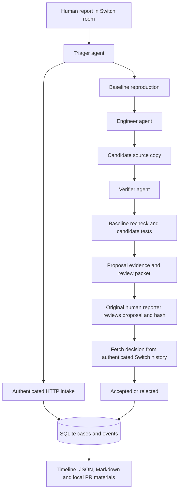

# Architecture

## Seven layers

1. **Intake:** original report, observed/expected fields, questions, optional
   authenticated Switch room/message origin.
2. **Orchestration:** native Switch template, three roles, explicit handoffs,
   bounded attempts, durable execution request IDs.
3. **Adapters:** source/test allowlists, snapshots, initial Git revision and
   status where available, explicit dependency policy.
4. **Proposals:** separate IDs, source snapshots, diffs, explanation and hashes.
5. **Verification:** isolated working copies, bounded POSIX subprocesses,
   structured unittest summaries, exact inventory comparison.
6. **Review:** authenticated reporter identity, exact candidate binding, stale
   message rejection and approval invalidation; local PR materials only.
7. **Storage:** SQLite transactions, append-only event history through the app,
   worker ownership, restart recovery and regenerable evidence exports.

## Persistence and failure behavior

Case mutations and request/proposal records use BEGIN IMMEDIATE transactions.
Long-running subprocesses execute outside the write transaction. Running states
prevent a second active operation on the same case. A repeated completed request
returns cached evidence. An active duplicate is refused without rerunning work.

A crashed process can leave reproducing/verifying state. `recover` checks recorded
worker PIDs, marks dead-owner requests interrupted and returns the case to an
appropriate retry state. A new request ID is required. Recovery preserves earlier
attempts and never fabricates execution results. PID reuse is a conservative
limitation: a reused live PID can delay recovery.

Files are derived exports, not transactionally committed alongside SQLite. If a
process stops during export, rerun `export`. Earlier proposal files are retained;
source and result records in SQLite are the recovery source.

## Trust and scope

The human identity decision trusts the configured Switch server's TLS/authenticated
responses and server-resolved sender kind. The application fails closed when the
server does not expose that information. It does not infer identity from names.

Agent processes sharing a user account can modify files or SQLite directly. This
prototype does not enforce a hostile-agent security boundary. Python candidates
must be trusted. A production service would need separate execution identities,
restricted containers, authenticated tools and signed or access-controlled storage.

No dashboard, autonomous merge, deployment, arbitrary repository execution,
automated hackathon registration, or GitHub publishing is implemented.
